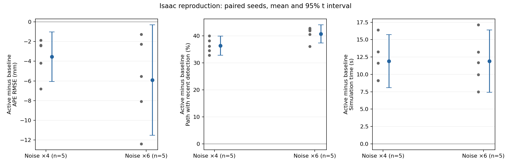

# Isaac reproduction evaluation

Original shelves_loop_a; noise ×4/×6; seeds42-46; five paired runs per mode.
evo1.38.0, XY, no alignment, GT interpolation .02s, RPE1m from reference.
Only goal window; no selective reruns; failed jobs retained.

Jobs 30/30; runner passed 28; Nav2 goals succeeded 90/90; strict pose goals 89/90.
Data/input audit failures 0; teardown failures 1.

## Noise ×4

| Metric | baseline | active | control |
|---|---|---|---|
| APE RMSE mm | 37.96 ± 1.71 (n=5) | 34.42 ± 0.90 (n=5) | 36.12 ± 2.07 (n=5) |
| APE max mm | 102.78 ± 10.35 (n=5) | 100.25 ± 8.96 (n=5) | 101.54 ± 11.43 (n=5) |
| RPE RMSE mm | 59.30 ± 9.45 (n=5) | 62.87 ± 4.74 (n=5) | 45.85 ± 2.60 (n=5) |
| Simulation time s | 36.83 ± 1.61 (n=5) | 48.73 ± 2.36 (n=5) | 42.15 ± 1.71 (n=5) |
| GT path m | 16.32 ± 0.03 (n=5) | 16.15 ± 0.06 (n=5) | 16.26 ± 0.08 (n=5) |
| Detections per m | 1.41 ± 0.35 (n=5) | 11.54 ± 0.95 (n=5) | 1.85 ± 0.36 (n=5) |
| Recent detection path % | 17.56 ± 1.70 (n=5) | 53.94 ± 2.39 (n=5) | 15.84 ± 2.22 (n=5) |
| Recent detection time % | 14.70 ± 1.35 (n=5) | 49.79 ± 5.11 (n=5) | 15.13 ± 1.75 (n=5) |
| Reported recovery count per run | 4.40 ± 2.51 (n=5) | 7.00 ± 3.08 (n=5) | 1.20 ± 1.10 (n=5) |
| Navigation RTF | 0.96 ± 0.00 (n=5) | 0.97 ± 0.00 (n=5) | 0.97 ± 0.00 (n=5) |

Paired differences use seeds as units, mean and 95% t interval (df=4 at n=5).

| Difference | Metric | Mean | 95% interval | n |
|---|---|---|---|---|
| active-minus-baseline | APE RMSE mm | -3.54 | [-6.06, -1.02] | 5 |
| active-minus-baseline | RPE RMSE mm | 3.57 | [-10.74, 17.89] | 5 |
| active-minus-baseline | Simulation time s | 11.89 | [8.08, 15.70] | 5 |
| active-minus-baseline | Detections per m | 10.13 | [8.96, 11.31] | 5 |
| active-minus-baseline | Recent detection path percentage points | 36.38 | [32.84, 39.92] | 5 |
| active-minus-control | APE RMSE mm | -1.70 | [-4.17, 0.76] | 5 |
| active-minus-control | RPE RMSE mm | 17.02 | [8.65, 25.40] | 5 |
| active-minus-control | Simulation time s | 6.58 | [2.74, 10.42] | 5 |
| active-minus-control | Detections per m | 9.70 | [8.35, 11.05] | 5 |
| active-minus-control | Recent detection path percentage points | 38.09 | [33.52, 42.67] | 5 |

## Noise ×6

| Metric | baseline | active | control |
|---|---|---|---|
| APE RMSE mm | 53.52 ± 4.69 (n=5) | 47.60 ± 1.14 (n=5) | 51.31 ± 2.78 (n=5) |
| APE max mm | 157.18 ± 8.69 (n=5) | 137.88 ± 19.69 (n=5) | 138.64 ± 19.24 (n=5) |
| RPE RMSE mm | 85.49 ± 11.67 (n=5) | 73.77 ± 11.37 (n=5) | 81.67 ± 13.85 (n=5) |
| Simulation time s | 40.91 ± 4.88 (n=5) | 52.81 ± 2.42 (n=5) | 45.36 ± 3.32 (n=5) |
| GT path m | 16.40 ± 0.10 (n=5) | 16.27 ± 0.04 (n=5) | 16.43 ± 0.03 (n=5) |
| Detections per m | 2.05 ± 0.87 (n=5) | 11.42 ± 0.57 (n=5) | 1.35 ± 0.82 (n=5) |
| Recent detection path % | 12.29 ± 4.64 (n=5) | 53.06 ± 2.81 (n=5) | 10.42 ± 4.45 (n=5) |
| Recent detection time % | 14.05 ± 2.63 (n=5) | 44.69 ± 2.63 (n=5) | 9.99 ± 4.45 (n=5) |
| Reported recovery count per run | 10.60 ± 7.50 (n=5) | 12.60 ± 3.65 (n=5) | 4.60 ± 3.65 (n=5) |
| Navigation RTF | 0.96 ± 0.00 (n=5) | 0.97 ± 0.00 (n=5) | 0.97 ± 0.00 (n=5) |

Paired differences use seeds as units, mean and 95% t interval (df=4 at n=5).

| Difference | Metric | Mean | 95% interval | n |
|---|---|---|---|---|
| active-minus-baseline | APE RMSE mm | -5.91 | [-11.51, -0.31] | 5 |
| active-minus-baseline | RPE RMSE mm | -11.72 | [-29.89, 6.45] | 5 |
| active-minus-baseline | Simulation time s | 11.90 | [7.41, 16.39] | 5 |
| active-minus-baseline | Detections per m | 9.37 | [7.96, 10.79] | 5 |
| active-minus-baseline | Recent detection path percentage points | 40.76 | [37.40, 44.13] | 5 |
| active-minus-control | APE RMSE mm | -3.71 | [-7.03, -0.39] | 5 |
| active-minus-control | RPE RMSE mm | -7.90 | [-24.05, 8.24] | 5 |
| active-minus-control | Simulation time s | 7.45 | [4.81, 10.08] | 5 |
| active-minus-control | Detections per m | 10.07 | [9.24, 10.90] | 5 |
| active-minus-control | Recent detection path percentage points | 42.64 | [39.02, 46.25] | 5 |

## Recorded exceptions

- reproduction-009-k4-s45-control: runner=failed, pose=passed, teardown=failed, actions=3.0/3, max final estimated yaw error=0.07061001701522862 rad.
- reproduction-009-k6-s44-control: runner=failed, pose=failed, teardown=passed, actions=3.0/3, max final estimated yaw error=0.16650582532353742 rad.

All pre-seed first-TF diagnostic flags are retained. Post-initialpose errors are audited separately.
Five seeds, one static map, uncontrolled MPPI RNG; intervals are descriptive, not a universal-method claim.

