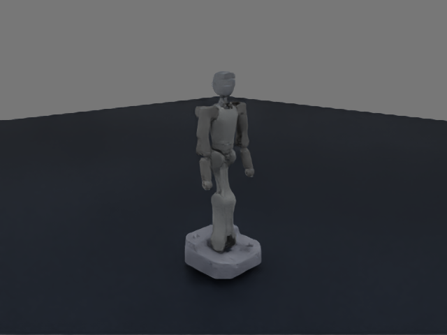
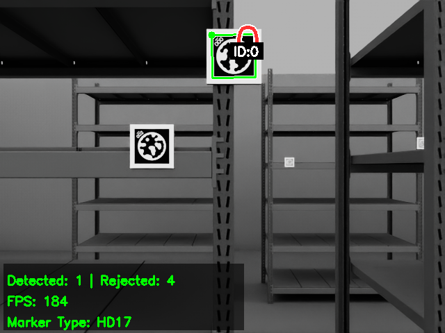
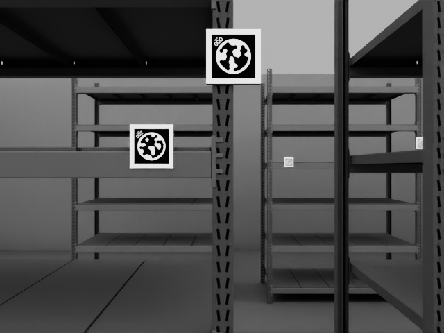

# Воспроизведение Active Localisation в Isaac Sim

9 ноября 2026

## 1 Цель и границы воспроизведения

Цель работы - воспроизвести решение Active Localisation для Astribot S1 в Isaac Sim, сохранив смысл эксперимента, ROS-интерфейсы и алгоритмы исходной реализации Gazebo. Перенос охватывает робота, движение, камеру, два лидара, мир с маркерами, новую карту RTAB-Map и три режима навигации. Исходный отчёт о Gazebo сохраняется как описание метода; этот документ посвящён процессу его воспроизведения.

Платформа воспроизведения: Isaac Sim 5.1.0, ROS 2 Humble, Nav2 1.1.20 и RTAB-Map 0.23.13. Смена симулятора отделена от смены ROS-дистрибутива: алгоритмические узлы работают с прежними сообщениями и сервисами, а специфическая для Isaac часть реализована в адаптере.

Основной принцип переноса - сначала восстановить измерения и управление, затем подключать прежние алгоритмы. Совпадение внешнего вида модели само по себе не подтверждает эквивалентность стенда: ошибка в системе координат датчика или в геометрическом размере маркера меняет эксперимент даже при правдоподобном изображении.

### Что сохранено

Сохранены ROS 2 Humble, omnidirectional-команды vx, vy, wz, исходная модель дрейфа одометрии, реальный детектор STag, RTAB-Map с лидаром и HD17-ориентирами, Theta*, MPPI Omni, дерево поведения и восстановления Nav2. Плагины LocalizabilityLayer и LocalizationAwarePlanner перенесены без изменения их алгоритмов. Направление камеры по-прежнему меняется поворотом базы независимо от направления движения.

| Компонент | Сохранённый контракт | Реализация в Isaac |
|---|---|---|
| База | cmd_vel → vx, vy, wz | Кинематическая база и swept footprint |
| Датчики | RGB/depth, CameraInfo, PointCloud2 | RTX-камера и PhysX-лидары |
| Одометрия и TF | GT отдельно; noisy odom → base | Прежняя модель дрейфа |
| Локализация | map → odom, STag HD17 IDs1-5 | Прежний RTAB-Map, новая карта |
| Навигация | NavigateToPose и три режима | Прежние Nav2 plugins/BT |

### Что означает успешное воспроизведение

Робот выполняет исходные сценарии через штатные действия NavigateToPose, а не через заранее записанную траекторию. Ориентиры обнаруживаются в изображении камеры. Оценка позы строится по шумной одометрии, лидару и принятым детекциям. Истинная поза служит входом модели шума и используется для проверки, но напрямую не передаётся в SLAM и Nav2. Сравнение baseline, active и control выполняется на одной новой карте с одинаковыми условиями начала эпизода.

Колёсная контактная динамика, балансировка и манипуляции не входили в исходный навигационный эксперимент. В Isaac сохранена плоская кинематическая база и фиксированная конфигурация тела. Поэтому результат относится к воспроизведению навигационного задания, а не ко всем физическим возможностям Astribot.

## 2 Модель робота и движение базы

За основу взяты URDF, исходная конфигурация позы и собственные mesh-файлы проекта. Модель импортирована в USD с сохранением структуры преобразований: 38 links, 37 фиксированных joints и 18 mesh-файлов. Поза рук и корпуса восстановлена из исходной конфигурации, чтобы не менять положение сенсоров относительно базы.

Рис. 1. URDF-модель Astribot из исходного проекта после импорта в Isaac Sim. Фиксированная поза соответствует навигационному эксперименту.

После импорта проверялись не только геометрия и масштаб, но и преобразования от base_link до камеры и лидаров. Высота base_link над полом сохранена равной 0,16 м. Перемещение в плоскости реализовано по тем же трём степеням свободы, которые использовались в Gazebo; боковая скорость не заменена ограничением дифференциальной базы.

### Движение и столкновения

Навигация публикует обычные команды скорости. Адаптер интегрирует позу базы, ограничивает допустимые скорости и останавливает движение при потере команд. Для неподвижного мира применяется проверка прямоугольного footprint по ориентированным препятствиям с проверкой промежуточного движения. Эта проверка препятствует проходу базы через стену или стеллаж, но не моделирует силы контакта колёс.

Общий профиль скорости составляет 0,6 м/с по x и y и 0,8 рад/с по yaw; одинаковые ограничения заданы базе, MPPI и сглаживателю. Это изменение исполнения относительно исходных значений явно разделено с алгоритмическими настройками и применяется во всех трёх режимах.

### Проверка движения

Внешний ROS-тест проверил движение вперёд и вбок, вращение, остановку по watchdog, остановку перед препятствием и сброс эпизода. Отдельно проверено, что шумная одометрия и истинная поза различаются, а единственным владельцем TF odom → base_link остаётся исходный узел модели дрейфа.

## 3 Камера лидары и ориентиры

Камера на торсе воспроизведена как RTX RGB/depth-камера с разрешением 640 × 480, горизонтальным полем зрения 1,089 рад и fx около 528,43 пикселя. Проверены optical-frame, CameraInfo и согласованность глубины. Сохранение этих параметров важно для исходного score видимости: он использует геометрическую площадь проекции маркера.

### Основная трудность с лидарами

У обоих лидаров восстановлены исходные extrinsics, азимуты, углы по высоте, дальности и шум. Использован штатный PhysX Generic Sensor с пакетами из 1920 лучей на датчик, а затем прежний узел сшивки облаков. В Gazebo elevation положителен вверх, а в выбранном API PhysX положительный zenith направлен вниз. Прямое копирование углов давало неверную геометрию; при переносе elevation меняет знак.

| Величина | Восстановленное значение | Фактическая проверка |
|---|---|---|
| GT / RGB+depth / lidar | 50 / 30 / 10 Гц по sim time | Внешний ROS-тест частот |
| Камера | 640 × 480, HFOV 1,089 рад | fx = 528,4337; optical-frame |
| Лидар | 120 × 16 лучей на датчик | p99 surface error около 2 см |
| Сшивка | Два исходных облака | Прежний lidar_stitching |

### Размер и ориентация STag

В мир перенесены исходные текстуры HD15 и HD17. Физический размер чёрного квадрата занимает 80% панели: для HD17 он равен 0,08 м, для HD15 - 0,064 м. Старое значение HD15 0,06 м не совпадало с геометрией текстуры и давало систематическую ошибку PnP; размер исправлен в адаптере, сам детектор сохранён.

В контрольных фронтальных наблюдениях медианная ошибка переноса составила около 3-8 мм; отдельно проверен ненулевой HD17 ID1 с ошибкой 9,27 мм. Это локальные контрольные измерения. При боковых ракурсах сохранилась неоднозначность IPPE и скачки нормали, а сырые детекции иногда содержали ложные ID. В RTAB-Map передаются только исходно разрешённые HD17 IDs 1-5 с проверками свежести и выбросов. Идеальные позы маркеров из симулятора не подставляются вместо детекций.

Рис. 2. Исходный HD17-детектор на кадре Isaac. ID0 - контроль фронтенда, для RTAB-Map разрешены IDs1-5. FPS в оверлее - обратная средняя длительность обработки, а не частота камеры.

## 4 Собственный мир и новая карта

Мир восстановлен из исходного SDF, а не заменён похожим складом. Перенесены шесть стеллажей, четыре стены и 24 панели STag. Для DAE-геометрии проверены единицы, масштаб 0,001 и вложенные model/link/geometry-преобразования. Ориентированные collision boxes совпадают с исходными; визуальные mesh и поверхности препятствий проверялись отдельно.

Рис. 3. Реальное изображение перенесённой сцены с torso-камеры. Текстуры маркеров используются детектором без передачи идеальных поз.

Для перенесённой сцены построена новая сенсорная карта RTAB-Map: 947 узлов и пять оптимизированных HD17-ориентиров. Использование старой Gazebo DB означало бы перенос результатов картирования, а не воспроизведение этапа в другом симуляторе. Положения ориентиров для планировщика экспортированы из оптимизированного графа новой карты.

### Память и полный граф

Неограниченное накопление рабочей памяти и кэшей привело к прерыванию первого картирования. Введён общий профиль: MemoryThr = 200, map_filter_radius = 0,15 м, map_filter_angle = 10° и отключённая предварительная загрузка кэша карты. Сырые измерения продолжают записываться в DB. Этот профиль одинаков для baseline, active и control.

После ограничения working memory обычный кэш оптимизированных поз содержал только часть ориентиров. Полный граф с long-term memory извлечён штатным API RTAB-Map и оптимизирован в отдельной копии DB. Проверки хешей подтвердили неизменность сырых данных, связей и исходных поз узлов. Ground truth и координаты объектов мира не использовались для оптимизации. Медианная ошибка XY пяти ориентиров относительно контрольных поверхностей сцены составила 1,74 см.

## 5 Воспроизведение протокола эксперимента

Пилот shelves_south_wall подтвердил перенос до основной серии: все шесть целей достигнуты. Active изменил маршрут относительно control в среднем на 0,444 м, а yaw - на 0,952 рад на общем участке. Работа плагинов проверена по фактическому движению и журналам загрузки.

Основная серия повторяет структуру Gazebo-задания: shelves_loop_a, три цели, шум ×4/×6, seeds 42-46 и три режима. Дисперсионные коэффициенты масштабируются как k², систематические ошибки - как k. Порядок режимов ротируется. Каждый эпизод получает новый симулятор, ROS-стек и отдельную копию карты; профили проверяются в живом ROS-графе.

Начальное перемещение Gazebo на 0,6 м заменено один раз заданной известной позой сценария. Во время целей ручные команды и коррекции по истинной позе не подаются. Одинаковый seed не даёт одинакового дрейфа на разных путях; RNG MPPI этим адаптером не управляется.

APE/RPE рассчитаны прежним pipeline на evo 1.38.0: XY, без выравнивания, интерполяция GT в моменты оценки с допуском 0,02 с, RPE через 1 м. Окно - от первой до последней цели, без начальной локализации. Аналитические контроли проверили сопоставление времени, отсутствие скрытого выравнивания и исключение разницы высоты.

| Метрика | baseline | active | control |
|---|---|---|---|
| Шум ×4 |  |  |  |
| APE RMSE, мм | 38.0 ± 1.7 | 34.4 ± 0.9 | 36.1 ± 2.1 |
| RPE RMSE, мм | 59.3 ± 9.5 | 62.9 ± 4.7 | 45.9 ± 2.6 |
| Детекции на метр | 1.4 ± 0.4 | 11.5 ± 0.9 | 1.8 ± 0.4 |
| Путь с детекцией за 1 с, % | 17.6 ± 1.7 | 53.9 ± 2.4 | 15.8 ± 2.2 |
| Время симуляции, с | 36.8 ± 1.6 | 48.7 ± 2.4 | 42.1 ± 1.7 |
| Шум ×6 |  |  |  |
| APE RMSE, мм | 53.5 ± 4.7 | 47.6 ± 1.1 | 51.3 ± 2.8 |
| RPE RMSE, мм | 85.5 ± 11.7 | 73.8 ± 11.4 | 81.7 ± 13.9 |
| Детекции на метр | 2.0 ± 0.9 | 11.4 ± 0.6 | 1.4 ± 0.8 |
| Путь с детекцией за 1 с, % | 12.3 ± 4.6 | 53.1 ± 2.8 | 10.4 ± 4.5 |
| Время симуляции, с | 40.9 ± 4.9 | 52.8 ± 2.4 | 45.4 ± 3.3 |

Учтено 30 из 30 запусков; достигнуто 90 из 90 целей. Значения - среднее ± выборочное стандартное отклонение по пяти seeds. Доля пути с недавней детекцией вычислена по длине пути, а не по времени стоянки. Неудачные запуски не удалялись из учёта.

Отдельные критерии приёмки выявили два исключения. В control ×6, seed44 конечная оценка yaw отличалась от цели на 0,1665 рад при дополнительном допуске 0,10 рад: строгую проверку позы прошли 89/90 целей. В control ×4, seed45 регистратор завершился с ошибкой после конца окна; файлы и счётчики полны. Поэтому общий runner имеет 28/30 успешных статусов при 90/90 успехах Nav2. Оба случая включены в оценку. Обработка сигналов регистратора исправлена после серии и отдельно проверена 20 остановками.

Таблица служит проверкой работоспособности перенесённого задания. Изменение симулятора, карты, сенсорной реализации и профиля исполнения не позволяет приписать различия с численными результатами Gazebo одной причине. Исходный отчёт по Gazebo не заменяется новой таблицей.

## 6 Основные выводы о процессе переноса

В Isaac Sim воспроизведены робот, собственная сцена, сенсорная локализация и исходные режимы навигации. В серии учтено 30 из 30 эпизодов; достигнуто 90 из 90 целей. Валидация охватывает реальные ROS-действия и траектории, а также проверку источников данных и условий сравнения.

### Что помогло

Перенос по контрактам ROS позволил сохранять алгоритмы и проверять каждый новый компонент отдельно. Исходные URDF/SDF, текстуры, конфигурация позы и параметры камеры дали проверяемую геометрическую основу. Внешние ROS-тесты выявляли ошибки, которые не видны по скриншоту: знак углов лидара, направление optical-frame, свежесть TF, владельцев преобразований и реальную частоту сообщений.

Разделение ground truth и оценки, новая карта из измерений, неизменная исходная DB и парные запуски защитили эксперимент от подмены локализации идеальной позой. Раздельные отчёты этапов и сохранение неудачных запусков позволили отличить предварительную диагностику от принятого результата.

### Наиболее существенные технические трудности

Первой была геометрическая эквивалентность: разные соглашения углов, вложенные преобразования mesh, размер маркера и ориентация сенсоров. Второй - временной и информационный контракт: /clock, timestamps, QoS CameraInfo, TF и реальные детекции. Третьей - воспроизводимый жизненный цикл: готовность рендера наступает позже старта приложения, обнаружение action server раньше активации Nav2, а остановка ROS-обёртки не всегда завершает дочерний процесс.

Производительность также влияла на достоверность стенда. Основным источником низкого real-time factor оказалась валидация миллионов байтов Python при присвоении ROS Image.data, а не рендер. Передача через штатный array.array('B') подняла RTF в диагностике примерно с 0,07 до 0,99 и восстановила частоты камеры и лидаров. Готовность каждого эпизода теперь определяется валидными сенсорными данными и состояниями lifecycle, а не фиксированной паузой.

### Границы результата

Подтверждено воспроизведение навигационного эксперимента на одной статичной сцене. Не подтверждены полная контактная динамика Astribot, качество PnP во всех ракурсах, длительная эксплуатационная надёжность и универсальное преимущество active localization. Сравнение эффективности метода требует учитывать интервалы парных различий и ограничения числа seeds; большее число детекций само по себе не доказывает снижение ошибки позы.

### Материалы воспроизведения

Исходный отчёт Active Localization в Gazebo и Nav2 от 20.10.2026; репозиторий Matveytrt/Active-Localisation, ветка isaac; TASK_REGISTRY.md и отчёты iterations/005-009. Исходные Gazebo algorithms сохранены. Версии, конфигурации, контрольные суммы, результаты действий и сырые траектории каждого эпизода сохранены отдельно от исходников.

Воспроизведение серии: python3 isaac/run_series.py --name UNIQUE_NAME. Одиночный эпизод: python3 isaac/run_experiment.py --batch UNIQUE_NAME --scenario shelves_loop_a --noise-scale 4 --seed 42 --modes active --complete-scenario. Все симуляционные запуски выполняются в среде Isaac; названия должны быть новыми, чтобы не перезаписывать доказательства.
